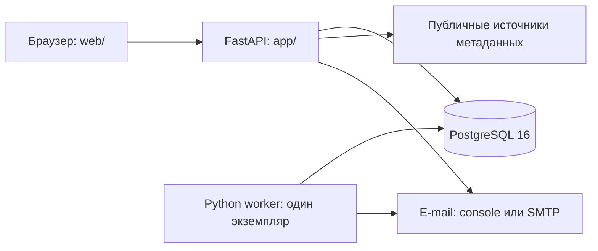
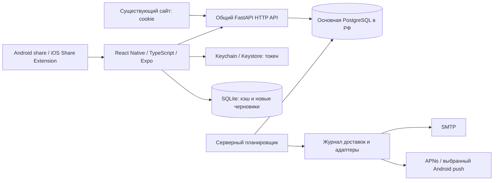

# Архитектура Teleiosis

Дата: 16.11.2026. Разделы «сейчас» описывают код; разделы «целевой контракт» — утверждённое направление, ещё не реализованное. Дорожная карта и входные условия: [mobile_plan.md](mobile_plan.md).

## Сейчас: веб-MVP

Сайт и API имеют один origin. Сайт написан на HTML/CSS/JavaScript без сборщика, раздаётся по `/app/`. Сервер: Python 3.12, FastAPI, синхронный SQLAlchemy/psycopg, Alembic. Старый docker-compose.yml запускает только БД. В мобильном блоке 1 добавлены Dockerfile, отдельный deploy/compose.yml (API/worker/БД/Caddy), backup/restore и GitHub Actions workflow; локальные проверки выполняются отдельно от remote CI и реального деплоя. Пользователь подтвердил успешный локальный закрытый тест; развёртывание на российском сервере ещё не проводилось. Runbook: [deployment.md](deployment.md).

В PostgreSQL девять таблиц: users, categories, contents, reminders, auth_sessions, rate_limit_events, password_reset_tokens, email_verification_tokens, user_activity. Основные операции проверяют владельца; чужой ресурс возвращает 404. Одна категория на материал, статусы unseen/planned/studied/irrelevant, UNIQUE(user_id, url_normalized). Схема: [database.md](database.md).

Пароли Argon2id; сессии случайные, хранится SHA-256 токена. Сайт использует HttpOnly SameSite=Lax cookie, Secure и __Host-имя в production; изменяющие запросы проверяют Origin. Период неактивности 14 дней, абсолютный максимум 60, до 10 сессий. Старые Telegram/Bearer-пути удалены. В блоке 1 production-документация API отключена, добавлен /ready для проверки подключения БД; /health сохраняет старый контракт. SMTP в prod требует TLS. Текущие endpoints: [api.md](api.md).

Метаданные загружаются синхронно best-effort. Воркер работает раз в минуту, один экземпляр с advisory lock; отправляет подборки и напоминания e-mail. Отправка at-most-once: сбой после фиксации не повторяется. Историческая модель не гарантирует доставку.

## Целевая структура первого мобильного релиза

`mobile/` создана в блоке 2: Expo SDK 58/RN 0.88.1, TypeScript и Expo Router, навигационный каркас и отдельные share/SecureStore probes без API/auth. Backend, сайт и основная БД остаются общими. React Native выбран для общего мобильного кода; TypeScript — для контрактов клиента; Expo — для сборки и платформенных модулей с development builds. Переход сайта на React/Vite и микросервисы не входят в план. Runtime-приёмка двух ОС пока открыта: [mobile_testing.md](mobile_testing.md).

HTML/CSS/DOM-компоненты сайта напрямую не переиспользуются. Сохраняются правила, серверная логика, API и светлая палитра из текущего web/css/app.css. Нативные модули допустимы для системного share и push. Точные версии SDK и минимальные ОС фиксируются только после проверки совместимости в блоке 2, до приёмки его результата.

## Целевой контракт авторизации (блок 3)

| Клиент | Credentials | Проверка |
|---|---|---|
| Сайт | Существующая HttpOnly cookie | Сессия типа web; SameSite и Origin для изменяющих запросов |
| Mobile | Authorization: Bearer <opaque-token> | Сессия типа mobile; без browser-cookie и без имитации Origin |
| Смешанный запрос | Cookie сессии + Authorization | 401; не выбирать один способ молча |

Тип сессии проверяется на сервере: web-токен не становится mobile-токеном при переносе в заголовок. Неподдерживаемый/некорректный Authorization не должен давать fallback на cookie. JWT и отдельный refresh-токен в первом релизе не требуются. В БД хранить только хэш, сроки первоначально оставить 14/60 дней, общий лимит 10 сессий. Различать срок текущей сессии и абсолютный предел.

Планируемый мобильный auth namespace — `/mobile/auth`, с регистрацией, входом, выходом, reset request/confirm и verification confirm. Это проектные имена, не доступные сейчас endpoints. Перед кодом блока 3 зафиксировать точные схемы в api.md. Успешный вход выдаёт профиль, токен и сроки с `Cache-Control: no-store`, без Set-Cookie. Проверки пароля, нормализации e-mail, consent и rate limit переиспользуют общую логику; нельзя копировать независимые правила.

Бизнес-ресурсы `/contents`, `/categories`, `/me`, `/stats` сохраняются. Мобильная auth-ветка добавляется без отмены web-CSRF и без включения CORS «для приложения»: нативный HTTP-клиент не требует browser CORS. Анонимные мобильные auth endpoints защищаются собственной валидацией и rate limit; отсутствие Origin не является доказательством доверия.

Токен — только в SecureStore/Keychain/Keystore; не в SQLite, URL, аналитике и логах. Выход отзывает текущую сессию; смена пароля сохраняет текущую и отзывает остальные web/mobile-сессии; сброс пароля отзывает все. Удаление аккаунта удаляет серверные данные и локальный кэш/очередь/токен. Ошибка 401 при отправке очереди приостанавливает её до повторного входа в тот же аккаунт. Автоматически повторять вход паролем нельзя.

Ссылки из писем: проверенные HTTPS Universal Links/App Links на собственном домене с веб-fallback. Сохранить работу существующих веб-ссылок; выдавать совместимые мобильные ссылки после настройки домена. Проверять host/path, одноразовость и срок, не передавать сессионный токен. Окончательный способ доставки reset/verify-токена в приложение проверить на обеих ОС, не полагаться на сохранение fragment при всех переходах. На iOS учесть сохранение Keychain после переустановки: новая установка не должна незаметно восстанавливать чужой локальный контекст.

## Целевой контракт кэша и очереди (блок 5)

Кэш содержит только загруженные страницы библиотеки и необходимые справочники. Это не обещание офлайн-копии всей библиотеки или содержимого внешних сайтов. Локальный поиск явно обозначает, что ищет среди загруженного. Снимок показывает время обновления; сервер остаётся источником истины для синхронизированных данных.

Новые URL/заметки сначала атомарно сохраняются в SQLite как черновики. UI отличает «сохранено на устройстве» от «сохранено на сервере». Редактирование существующих ресурсов и расписаний требует сети; черновик можно изменить до начала отправки. После начала отправки payload и ключ фиксируются до разрешения неопределённого результата.

| Состояние | Значение / переход |
|---|---|
| pending | Локально сохранён; ожидает сети и подходящей сессии |
| sending | Одна попытка активна; повторный запуск приложения возвращает неопределённую попытку в pending с тем же ключом |
| retry_wait | Сетевая ошибка, 5xx или 429: backoff с jitter, для 429 учитывать Retry-After |
| needs_auth | 401: автоматическая отправка остановлена до входа в исходный аккаунт |
| needs_action | Невалидные данные, чужая/удалённая категория, конфликт: показать причину и выбор исправления |
| synced | Получено подтверждение и server_id; обновить кэш, затем завершить локальную операцию |

Каждая операция имеет UUID, owner_id и версию payload. Повторы одной операции используют тот же ключ идемпотентности. Сервер связывает ключ с пользователем и отпечатком запроса; повтор возвращает тот же результат, другой payload с тем же ключом даёт конфликт. Запись результата и создание материала должны быть атомарны; параллельные запросы не создают две заметки. Отдельно обработать existing_id при совпадении нормализованного URL. Не подменять этим дедупликацию разных осмысленных заметок.

Срок хранения ключей и допустимый срок автоматического повтора определить перед реализацией блока 5. После удаления материала старый повтор не должен создавать его заново: запись идемпотентности переживает удаление в рамках этого срока; просроченная неопределённая операция требует решения пользователя, а не нового UUID автоматически.

Кэш и очередь разделены по аккаунтам. При выходе с неотправленными данными показать выбор: остаться и отправить либо явно удалить черновики и выйти. Не переносить очередь в другой аккаунт. До входа share хранится как отдельный локальный черновик; принадлежность аккаунту назначается только после входа и подтверждения пользователем. Истёкшая сессия сама по себе не удаляет черновик.

Обновление: запуск, возврат приложения на передний план, возврат к библиотеке и ручное обновление. Заново загруженная страница заменяет свой снимок; отсутствие записи в одном ответе с фильтром не означает глобальное удаление. 404 карточки удаляет её из кэша. Без журнала изменений старый кэш может быть устаревшим до сверки с сервером; это должно быть видно пользователю. Постоянная фоновая синхронизация не обещается.

Для онлайн-редактирования добавить явную версию ресурса и атомарную условную запись; устаревшая версия даёт конфликт с возможностью перечитать данные. Старые веб-клиенты сохраняют текущий контракт, но любое успешное изменение должно увеличивать версию на сервере. Полная защита редактирования в обоих направлениях потребует передачи версии и веб-клиентом; её точечное внедрение согласовать в блоке 5, не заявлять уже существующей гарантией.

## Share и хранение на устройстве

Первый релиз принимает одну ссылку или текстовую заметку, с подтверждением сохранения. Если текст содержит несколько URL, не сохранять их автоматически все: предложить выбор одного либо сохранение текста как заметки. Файловые вложения, пакетный импорт и загрузка медиа не входят. Ссылка на PDF обрабатывается как URL, сам PDF не скачивается.

Проверить Android ACTION_SEND и iOS Share Extension в холодном/обычном запуске, при отмене, блокировке, истёкшей сессии, отсутствии сети и повторном событии. На iOS предпочесть поддерживаемую Share Extension, сохраняющую минимальный payload в App Group: расширению не нужен сессионный токен и оно не обязано обращаться к сети. Не считать экспериментальный expo-sharing production-решением без проверки. Локальные данные защищаются sandbox/защитой ОС; кэш, очередь и общие данные расширения исключаются из автоматических облачных бэкапов. Детали encryption-at-rest и доступности при заблокированном устройстве фиксируются по результатам блока 2.

## Уведомления (блок 7)

Расписание и UTC хранятся на сервере; пользователь выбирает IANA-пояс, его нельзя молча заменять поясом телефона. Локальные напоминания не дублируют серверные. UI показывает пояс перед сохранением. Канал выбирается отдельно от системного разрешения; отказ в разрешении не блокирует библиотеку. Подтверждение e-mail требуется для почтового канала, но не является техническим условием push. Существующий веб-флаг reminders_enabled и его отписка сохраняют почтовой смысл при добавлении отдельных мобильных настроек; не включать push молча при отписке от e-mail.

Рекомендуемые адаптеры: APNs/iOS и проверка RuStore Push/Android; FCM при выбранном дополнительном канале. Конкретные аккаунты и покрытие устройств остаются входными зависимостями. Приложение работает без Google-сервисов в основном сценарии; обещание push на таких устройствах требует испытаний выбранного провайдера.

Планируемые сущности: устройства/регистрации и журнал доставок (идентификатор события, канал, устройство при необходимости, попытки, next_attempt_at, итог). Событие и запись на доставку создавать транзакционно. При retry перепроверять отмену, настройки и статус материала, учитывать TTL, удалять недействительные токены. Выход отвязывает устройство; удаление аккаунта удаляет регистрации и ожидающие доставки. Не объявлять существующий Reminder.status='sent' подтверждением фактической доставки.

Push содержит минимум информации без текста заметок, URL и e-mail; материал загружается после авторизации. Проверка владельца обязательна и после перехода по уведомлению. Для нескольких устройств одна доставка на событие/устройство допустима; повторы одной доставки дедуплицировать. Между БД и провайдером возможен неопределённый результат, поэтому «ровно один раз» не гарантируется. Сроки catch-up, TTL и политика нескольких каналов уточняются перед блоком 7; маркетинговые сообщения не входят.

## РФ, инфраструктура и совместимость

Основные API/БД, бэкапы и серверные журналы планируются в РФ. Юридический checklist — проверка операторского статуса, применимости уведомлений РКН, согласий/политики, целей и сроков обработки, удаления/бэкапов, договоров с SMTP/push/диагностикой, трансграничной передачи. Это задачи юриста до внешнего теста, не заключение о соответствии 152-ФЗ. Зарубежный CI не получает реальные пользовательские данные; его использование для закрытого кода/ключей согласуется отдельно.

Без рекламных SDK, зарубежной аналитики и обязательного Expo Push Service/EAS по умолчанию. Способ сборки, хранение signing-ключей и стоимость согласовать по реальным ресурсам. Данные токенов и паролей не печатать. Доступность SMTP, APNs/Android push и внешних метаданных проверяется из выбранной инфраструктуры и в сетях РФ.

Сохранять действующие URL и формы ответов API сайта. Новые поля/миграции делать совместимыми с предыдущим клиентом; удаление полей и повышение минимальной версии клиента требуют отдельного решения. Время передаётся timezone-aware, id остаются BIGINT; до генерации TypeScript-клиента определить безопасное представление id за пределами Number.MAX_SAFE_INTEGER, без слепого преобразования в JS number.

CI и релизные проверки описаны в mobile_plan.md. Для последующих функций добавлять только необходимые таблицы/сервисы; объектное хранилище, полнотекстовый/векторный индекс и платёжные сущности не создавать заранее.

## Первичные технические источники

Просмотрены при аудите 16.11.2026; совместимость конкретных версий повторно проверить в блоке 2:

- [React Native: framework и Expo](https://reactnative.dev/docs/environment-setup).
- [Expo: custom native code](https://docs.expo.dev/workflow/customizing/).
- [Expo Sharing: экспериментальный входящий share и ограничение iOS](https://docs.expo.dev/versions/latest/sdk/sharing/).
- [Expo SecureStore: Keychain/Keystore и переустановка](https://docs.expo.dev/versions/latest/sdk/securestore/).
- [Expo: прямая отправка APNs/FCM](https://docs.expo.dev/push-notifications/sending-notifications-custom/).
- [RuStore Push React Native: условия работы, пример версии 6.0.0](https://www.rustore.ru/help/sdk/push-notifications/react/6-0-0). Не считать эту версию выбранной для проекта.
